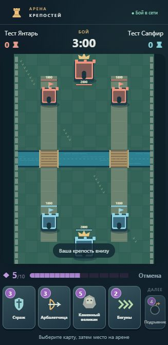

# Арена крепостей

Автономная браузерная игра для домашней сети. Два участника сражаются, остальные наблюдают. До 8 участников в одной комнате. Компьютер и телефон могут быть игроком или зрителем. Все игровые ресурсы нарисованы локально средствами Canvas и SVG.

## Установка и запуск

Нужен Node.js 22 или новее с npm. Откройте терминал в этой папке:

```powershell
npm install
npm start
```

В дальнейшем достаточно `npm start` или двойного щелчка по `start.bat`. Сборка входит в запуск. После установки зависимостей интернет не нужен: нет CDN, облачных API и внешних изображений. Не удаляйте `node_modules`, если планируете запускать игру без интернета.

`start.bat` также умеет использовать уже имеющийся в Codex комплект Node.js, когда обычного Node.js нет в PATH. Эта ветка требует уже установленных зависимостей.

Остановка: **Ctrl+C** в терминале сервера или `stop.bat` (в том числе для запущенного в фоне экземпляра). `stop.bat` проверяет сохранённый PID, имя процесса, команду и время запуска и останавливает только соответствующий сервер. Сервер слушает `0.0.0.0:3000` и отдаёт страницу, QR-код и WebSocket на одном порту. На компьютере откройте `http://localhost:3000`. Введите имя. В лобби показаны участники, реальные IPv4 компьютера и QR-код. Выберите адрес сетевой карты, которая подключена к домашнему роутеру. Виртуальные и VPN-интерфейсы идут в конце списка.

Пример адреса для телефона: **http://192.168.1.100:3000**. Это только пример: используйте фактический IPv4 вашего компьютера из лобби или вывода сервера. При смене сети адрес может измениться.

## Телефоны и порядок игры

1. Компьютер и телефоны должны находиться в одной локальной сети. Компьютер может быть подключён кабелем, телефоны — к Wi-Fi того же роутера.
2. На телефоне отсканируйте QR-код в лобби или введите показанный адрес. `localhost` на телефоне означает сам телефон: используйте IPv4 компьютера.
3. Каждый участник вводит имя. Первое подключённое устройство становится ведущим. Ведущий может назначить любые два устройства синему и алому месту; участник также может сам занять свободное место.
4. Оба игрока нажимают «Я готов» — матч начинается автоматически. Остальные видят весь бой.
5. Нажмите карту, затем место на арене. На компьютере работает мышь; дополнительно можно перетащить карту. Повторное нажатие карты, «Отмена» или Esc отменяют выбор. Энергия списывается только после проверки сервером.
6. Своя крепость всегда снизу. У зрителей фиксированный вид со стороны синей крепости. Войска размещаются на своей половине, вне башен; заклинания — по всей арене. Подсветка показывает область, круг — радиус заклинания.
7. После результата оба игрока могут подтвердить реванш. Для смены участников вернитесь в лобби и выберите места заново. Компьютер может всё время оставаться зрителем.

Одна вкладка на один адрес браузера использует одну сессию. Для двух игроков на одном компьютере используйте разные браузерные профили либо `localhost` и `127.0.0.1`. Открытие одной сессии во второй вкладке переносит её туда. При перезагрузке страницы имя, сторона, карты и энергия восстанавливаются по локальному токену.

## Порт и проблемы подключения

Изменение порта в PowerShell:

```powershell
$env:PORT=3100
npm start
```

В cmd: `set PORT=3100`, затем `npm start`. QR-коды будут содержать новый порт.

Если телефон не подключается:

- Проверьте, запущен ли сервер, и открывается ли игра на компьютере.
- Проверьте IPv4 и порт. Адрес VPN обычно не подходит для домашнего Wi-Fi. В списке можно выбрать другой интерфейс.
- Телефон не должен пользоваться только мобильным интернетом или другой Wi-Fi-сетью.
- Гостевые сети, AP/client isolation и некоторые mesh-настройки изолируют устройства. Используйте основную домашнюю сеть с разрешённым обменом между устройствами.
- Разрешите Node.js входящие подключения на TCP-порт игры в брандмауэре Windows **для частной сети**. При наличии явного правила Block его также нужно скорректировать: отдельное правило Allow не перекрывает Block. Сервер не изменяет эти настройки автоматически.
- Если порт занят, остановите старый экземпляр игры или задайте другой `PORT`.

## Механика и баланс

Конфигурация карт и числовые параметры находятся в `src/shared.ts` (`CARDS`, `BALANCE`). У каждого игрока одинаковая колода из 8 карт, 4 карты в руке и очередь из 4. Использованная карта отправляется в конец очереди. Следующая карта видна справа от руки. Полные описания есть в лобби.

| Карта | Энергия | Здоровье | Урон | Особенность |
|---|---:|---:|---:|---|
| Страж | 3 | 520 | 85 | Ближний бой, удар раз в 0,9 с |
| Арбалетчица | 3 | 240 | 65 | Дальность 155, раз в 1,05 с |
| Каменный великан | 5 | 1650 | 125 | Только здания, медленное движение |
| Бегуны | 2 | 130 × 3 | 38 каждый | Три быстрых бойца |
| Подрывник | 4 | 290 | 115 | Бомба с радиусом поражения 52 |
| Железный рыцарь | 6 | 1100 | 190 | Сильный бронированный боец |
| Огненный удар | 4 | — | 260 | Мгновенный урон, радиус 82 |
| Ледяное поле | 3 | — | — | 6 с, радиус 95; скорость движения и атак ×0,45 |

Энергия: 5 в начале, максимум 10; восстановление 0,55/с, в дополнительное время 1,1/с. Защитные башни имеют 1800 здоровья, центральная крепость — 2800. Все живые башни автоматически стреляют с начала матча.

Войска выбирают ближайший мост при размещении. Ближние враги в радиусе обнаружения имеют приоритет над зданиями; выбранная живая цель удерживается, пока остаётся рядом. После гибели или удаления цели отряд выбирает новую и продолжает движение. Великан игнорирует войска. Без ближних целей отряд движется к ближайшему живому вражескому зданию. Наземное движение пересекает реку только внутри двух мостов; отряды раздвигаются и огибают здания. Ледяное поле замедляет также частоту атак вражеских башен в зоне. Снаряды следуют за живой целью; бомбы взрываются и при гибели исходной цели.

Центральная крепость даёт немедленную победу, одновременное разрушение обеих — ничью. Через 180 секунд сравнивается число разрушенных башен. При равенстве начинается 60 секунд до первой разрушенной башни; при отсутствии победителя — ничья. Результат включает счёт башен, число карт и нанесённый урон.

## Техническое устройство

- Node.js + TypeScript, `ws`, локальный генератор QR `qrcode`.
- Авторитетный сервер: симуляция 20 раз/с, снимки примерно 10 раз/с. В браузере позиции интерполируются между снимками, эффекты анимируются через `requestAnimationFrame`.
- Сервер проверяет владельца, фазу, наличие карты в руке, энергию, границы, сторону размещения, препятствия и идентификатор команды. Повторные команды в рамках матча не выполняются. Введены предел размера сообщений и частоты команд.
- Сессии хранятся в памяти, токен — в localStorage браузера. Краткое отключение сохраняет место; после 30 секунд отсутствия игрок получает техническое поражение. WebSocket ping/pong обнаруживает также незакрытые «зависшие» соединения. При отключении обоих игроков — ничья. Ведущим становится другое подключённое устройство.
- Один процесс, одна комната. Перезапуск сервера сбрасывает текущий матч и сессии. Регистрации, постоянной базы, магазина и онлайн-подбора нет.

## Проверки

```powershell
npm test
```

Результаты фактической проверки этой версии перечислены в `TEST-REPORT.md`. Автотесты используют отдельный локальный порт, не затрагивая запущенную комнату. Условия конца боя в них ускоряются через состояние тестового экземпляра сервера; в обычном интерфейсе таких команд нет.

Первая версия предназначена для доверенной домашней сети. Нет сохранения матча на диск, защиты от повторного вступления после перезапуска сервера и сетевого поиска компьютера. Игроки подключаются по QR/адресу. Звук и бот не входят в эту версию. Реальные телефоны, сканирование QR камерой и проходимость брандмауэра нужно проверить на ваших устройствах.

## Известная проблема при проверке

По сообщению пользователя, **проблема доступа с телефона устраняется отключением брандмауэра Windows**. Диагностика компьютера выявила явное блокирующее входящее TCP-правило для Node.js в частной сети. Отключение брандмауэра — обходной способ устранить эту блокировку. Для постоянной настройки с работающим брандмауэром разрешите игре TCP-порт 3000 в частной домашней сети и скорректируйте существующее явное блокирующее правило: отдельное разрешение Allow не перекрывает Block. Изменение правил требует прав администратора. Агент не отключал брандмауэр и не менял его правила.




